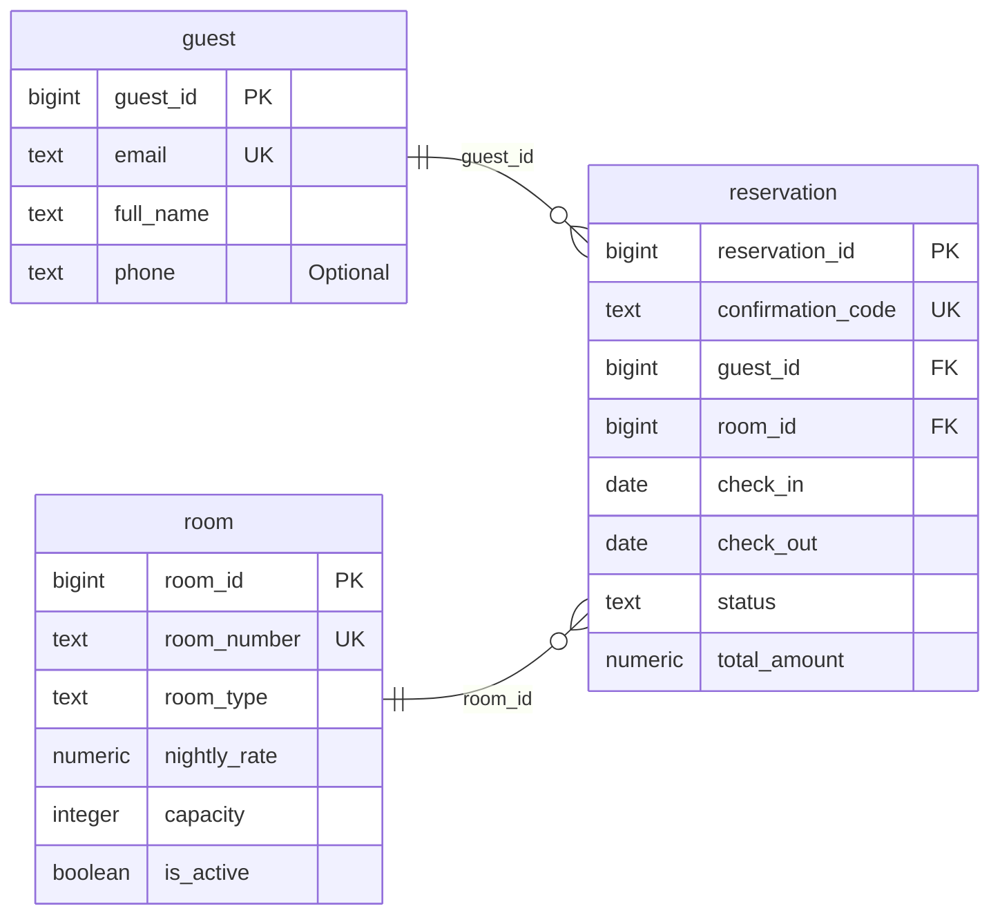

# Hotel Reservation System — ER diagram

PK identifies a record; FK links to another table; UK marks a single-field unique value. The relationship ends show exactly one, zero or one, or zero or many records. Composite unique keys and conditional rules are listed in the schema and design.

[Diagram image](../images/Mamman_Donald_301932758_ERDiagram.png)
